# AI-Driven Software Engineering - Practice #13

**Name:** Tukubayev Kudaibergen  
**ID:** 24B031114  
**Model:** Claude Opus 5.5 (claude-opus-5-5)  
**Topic:** Compare code-based and low-code solutions

**Links**

- Code-based live demo: https://claude.ai/artifact/7hLog28ZmLb6RsnG6f3RvQ
- Low-code live demo (Appsmith, public): https://app.appsmith.com/app/smart-campus-checker-p13-low-code/page1-6b05a3dd177cd4bd6b01e9ba
- Public repository (code, tests, Appsmith export, report, screenshots): https://github.com/tulki/smart-campus-p13

# Task #01 - Freeze the baseline

Baseline = my final code-based Smart Campus checker from Practice #11/#12, published version `1795281215-089d` (https://claude.ai/artifact/HNWMwQNuZejGht4x3YTHey). I did not change it.

- Booking data: 5 fictional rooms (Biology Lab is blocked), 5 bookings, e.g. Business 220 has 10:00-11:00; reference current time 08:30.
- Expected behavior: start after current time, end by 24:00, max 120 minutes, blocked room and overlapping booking are Unavailable, touching endpoints are allowed, bookings are never changed.
- Existing checks: the old Practice #08 test suite is not in this workspace, so I copied the baseline engine unchanged into `baseline/baseline_checks.mjs` and ran 8 checks with Node's test runner: **8 / 8 passed**.

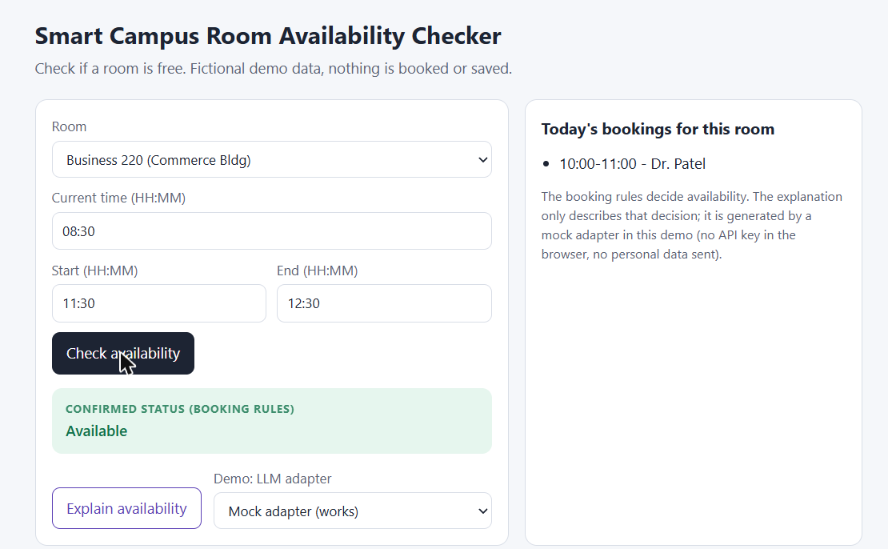{width=75%}

I kept the same booking rules for both new solutions. The only change is the contract from Task #02 (start time + duration instead of start + end, one room with a blocked flag), and it is the same for both approaches.

\newpage

# Task #02 - Shared requirement / acceptance-criteria sheet

**User story:** As a student, I want to choose a future start time and a duration for Study Room A, so that I can see right away if the room is Available or Unavailable and why.

| ID | Acceptance criterion |
|----|----------------------|
| AC1 | Start time must be in the future (strictly after the reference current time). |
| AC2 | Duration must be greater than zero and at most 120 minutes. |
| AC3 | An interval that overlaps an existing booking is Unavailable (touching endpoints do not overlap). |
| AC4 | A blocked room is Unavailable. |
| AC5 | The page shows a clear decision and never changes the existing bookings. |
| AC6 | Invalid input (empty, wrong format, not a whole number, ending after 24:00) gets an understandable message. |

**Inputs**

| Input | Type | Notes |
|-------|------|-------|
| startTime | text "HH:MM" | 00:00-23:59 |
| duration | whole number of minutes | 1-120 |
| blocked | boolean | Room status Open / Blocked |
| bookings | fixed fictional list | B1 09:00-10:00 Algorithms lecture, B2 12:00-13:00 Study group, B3 14:00-15:00 Lab session |
| now | text "HH:MM" | reference clock, default 08:30 so tests are repeatable |

**Outputs**

| Output | Values |
|--------|--------|
| available | true / false |
| reasonCode | AVAILABLE, OVERLAP, ROOM_BLOCKED, INVALID_DURATION, PAST_START, INVALID_START, INVALID_NOW, ENDS_NEXT_DAY |
| message | visible text, starts with "Available:", "Unavailable:" or "Validation error:" |

Check order: validation (AC6, AC2, AC1) first, then blocked (AC4), then overlap (AC3).

**Common test inputs (prepared before implementation, now = 08:30)**

| ID | startTime | duration | blocked | Expected |
|----|--------|--------|--------|------------------------------|
| T1 | 10:30 | 60 | false | Available |
| T2 | 09:30 | 60 | false | Unavailable - OVERLAP (09:00-10:00) |
| T3 | 10:30 | 60 | true | Unavailable - ROOM_BLOCKED |
| T4 | 10:30 | 0 | false | Validation error - INVALID_DURATION |
| T5 | 10:30 | 121 | false | Validation error - INVALID_DURATION |
| T6 | 08:00 | 30 | false | Validation error - PAST_START |
| T7 | 10:00 | 120 | false | Available - 10:00-12:00 touches B1 (ends 10:00) and B2 (starts 12:00) |
| T8 | after T1-T7 | - | - | bookings identical to the start |

\newpage

# Task #03 - Code-based solution

Plain HTML/JavaScript, no frameworks and no npm dependencies. The three parts are separate files in `code-based/src/` and `build.js` inlines them into one `index.html` for the live demo:

- `rules.js` - validation (`validateRequest`) and availability calculation (`calculateAvailability`), no DOM code. Bookings are `Object.freeze`d.
- `ui.js` - display only: reads the form, calls `Rules.checkRoom`, shows the result with `textContent`.
- `cases.js` - the shared T1-T8 inputs, used by the Node tests and by the "Run tests" panel on the page.

```js
function checkRoom(req, bookings = BOOKINGS) {
  const v = validateRequest(req);            // AC1, AC2, AC6
  return v.ok ? calculateAvailability(v.value, bookings) : v.result;  // AC4, AC3, AC5
}
function overlaps(aStart, aEnd, bStart, bEnd) {
  return aStart < bEnd && bStart < aEnd;     // touching endpoints are not an overlap
}
```

Node test run (`node --test tests/acceptance.test.js`): **9 / 9 passed** (T1-T8 plus an extra AC6 check with an empty value, `25:00`, `<script>`, `abc`, `30.5` and an interval ending after 24:00).

The page is a grid with two cards on desktop and one column under 720 px.

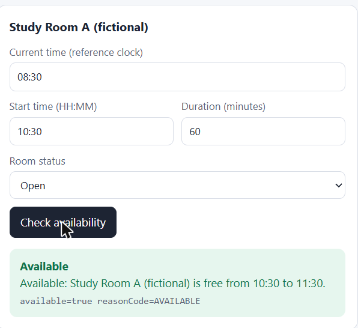{width=45%} 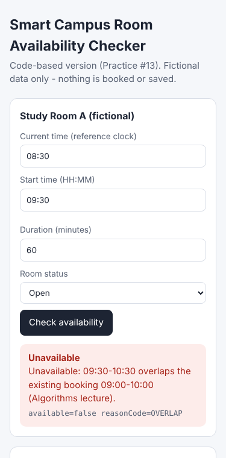{width=33%}

\newpage

# Task #04 - Low-code solution (Appsmith)

Platform: Appsmith Cloud, free plan (no subscription bought). App "Smart Campus Checker P13 (low-code)", deployed and public.

- Widgets: `tblBookings` (Table, data `{{Rules.bookings}}`), `inpNow` (default 08:30), `inpStart`, `inpDuration` (max 5 / 4 characters), `swBlocked` (Switch "Room blocked", default off), `btnCheck` (onClick `{{Rules.run()}}`), `txtResult` (Text bound to `appsmith.store.result`).
- No datasource and no connector: the same three fictional bookings are a constant in the JS object.
- One small script was necessary: the JS object `Rules` with `check()` (same contract and same order of checks) and `run()`, which saves the result with `storeValue`. Doing the overlap search and six rules only with widget expressions would have been one long unreadable binding, so I kept it in one JS object. Full code: `low-code/Rules.jsobject.js`; full app export: `low-code/appsmith-export.json`.

**Requirements the platform could not implement:** none of AC1-AC6 failed. Limits I recorded:

- Max characters is checked only in the browser (it is a widget setting), the same as `maxlength` in the code version.
- No automated test runner for widget behavior on the free plan, so T1-T8 were run by hand in the deployed app.
- In the editor, the visual canvas reflowed widgets when I placed them, and I had to delete and re-add four widgets to get a clean layout (see Task #06).

Nothing in the low-code app is simulated: all 8 results below come from the deployed app.

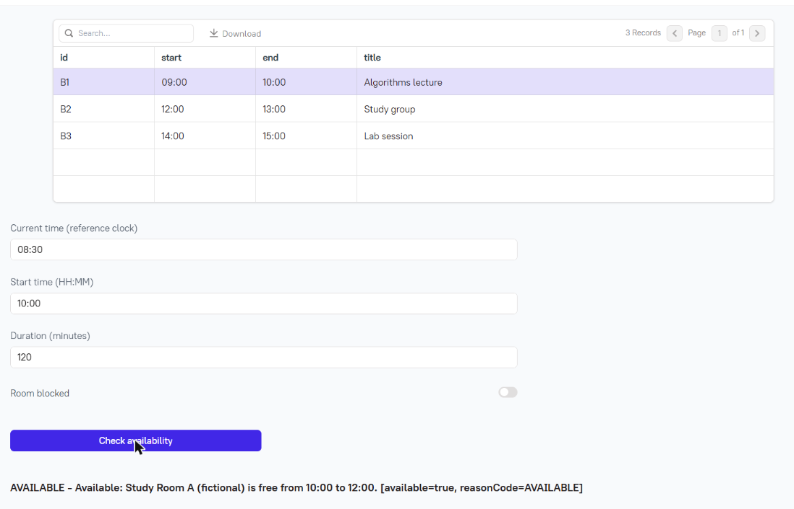{width=80%}

\newpage

# Task #05 - Eight-case test table

Observed = what each deployed app showed (screenshots in the repository, `report/code_T*.png` and `report/low_T*.png`).

| ID | Expected | Code-based observed | Low-code observed |
|---------|------------|-------------------------|-------------------------|
| T1 | Available | Available (AVAILABLE) - PASS | Available (AVAILABLE) - PASS |
| T2 | Unavailable, overlap | Unavailable, overlaps 09:00-10:00 (OVERLAP) - PASS | Unavailable, overlaps 09:00-10:00 (OVERLAP) - PASS |
| T3 | Unavailable, blocked | Unavailable: the room is blocked (ROOM_BLOCKED) - PASS | Unavailable: the room is blocked (ROOM_BLOCKED) - PASS |
| T4 | Validation error | Duration must be greater than 0 and at most 120 (INVALID_DURATION) - PASS | same message (INVALID_DURATION) - PASS |
| T5 | Validation error | same message (INVALID_DURATION) - PASS | same message (INVALID_DURATION) - PASS |
| T6 | Validation error | Start time must be in the future, after 08:30 (PAST_START) - PASS | same message (PAST_START) - PASS |
| T7 | Available | Available 10:00-12:00 (AVAILABLE) - PASS | Available 10:00-12:00 (AVAILABLE) - PASS |
| T8 | Bookings unchanged | Frozen data, JSON equal before/after (Node + page panel) - PASS | Table still shows the same 3 rows after T1-T7 - PASS |
| **Total** | | **8 / 8** | **8 / 8** |

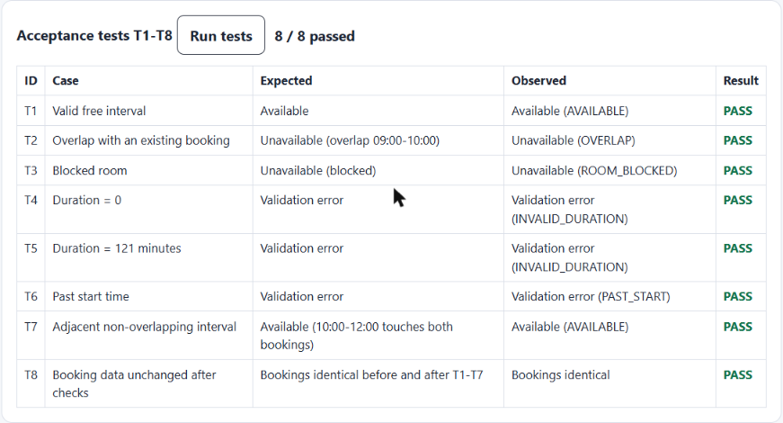{width=80%}

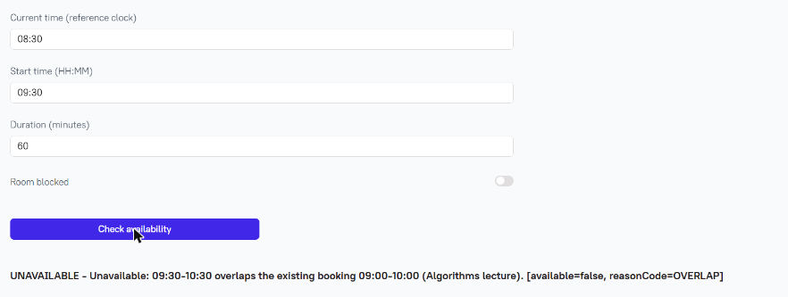{width=49%} 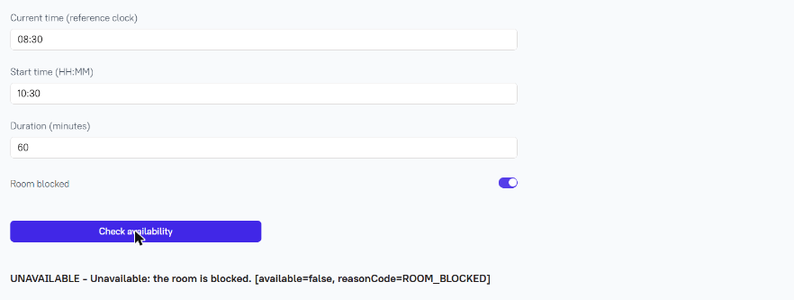{width=49%}

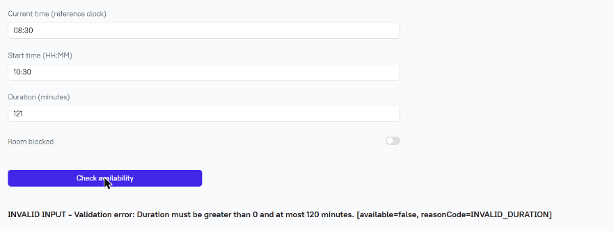{width=49%} 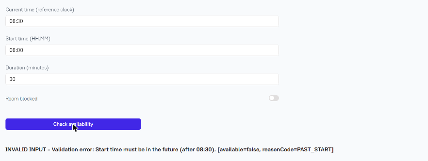{width=49%}

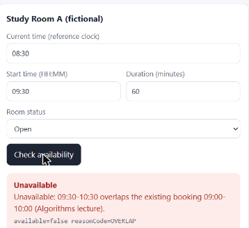{width=32%} 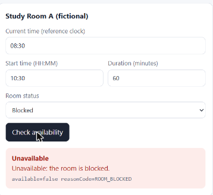{width=32%} 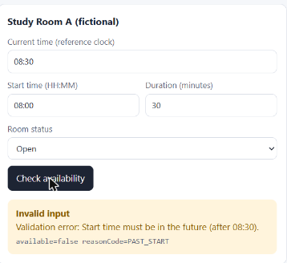{width=32%}

\newpage

# Task #06 - Engineering effort

**Measured** (timestamps from `timelog.txt`; both apps were built by me with the AI agent, the low-code one by the agent driving Appsmith in my browser):

| Phase | Code-based | Low-code |
|-------|------------|----------|
| Setup | ~0.5 min (folder, no installs) | ~0.5 min (skip datasource step, open editor) |
| Implementation | ~1.5 min (rules, UI, tests, build) | ~5 min (JS object, 7 widgets, bindings) |
| Debugging / rework | ~0.5 min (wrong `node --test` argument, no code bug) | ~4.5 min (property edits lost when set too fast, canvas reflow, deleted and re-added 4 widgets) |
| Testing T1-T8 | ~1.2 min (Node run + UI runs + panel) | ~1.3 min (manual runs in deployed app) |
| **Build and repair total** | **~3.6 min** | **~9.7 min + 1.3 min tests** |
| Acceptance tests passed | 8 / 8 | 8 / 8 |
| Unresolved defects | 0 | 0 |

**Review, export and version control (observed)**

- Code-based: every change is a text diff in Git and can be reviewed in a pull request; tests run with one command; the page is one HTML file that runs anywhere.
- Low-code: changes are made in the visual editor and saved automatically, there is no diff by default. Export is a 49 KB JSON (I pulled it through the Appsmith export API); it can be diffed but is mostly widget layout metadata. Appsmith has "Connect Git" in the editor, which I did not use.

**Personal impressions (not measured):** for me the code version was easier to reason about because all rules are in one file with tests. The low-code editor is fast for the screen itself, but the real logic still ended up in a script, and fixing the layout took longer than writing the rules. The times are AI-agent times, so a human would be slower in both, and the drag-and-drop problems were partly caused by automating a visual editor.

# Task #07 - Security review (Lecture #12)

| Check | Code-based | Low-code (Appsmith) |
|-------|------------|---------------------|
| Input validation | strict regex for HH:MM, whole-number duration, range checks, `maxlength` 5/4 | same rules in `Rules.check()`, Max characters 5/4 |
| Output handling / XSS | only `textContent`, no `innerHTML`; messages never echo raw input | messages never echo raw input; Text widget shows only built strings |
| Injection | no database, no queries, no `eval` | no datasource and no queries |
| Permissions / sharing | artifact is private by default and I share it publicly from claude.ai only for the demo; viewers get a read-only page | app was private (only me as Administrator), then made public on purpose for the demo; viewers cannot edit; the editor stays private |
| Secrets | none (no API keys, no backend) | none (export has no password/token fields, 0 datasources) |
| Connector access | none | none (skipped the datasource step) |
| Dependencies (SCA) | 0 runtime dependencies; Node built-in test runner only - nothing to patch | 0 custom JS libraries; platform updates are Appsmith's responsibility; I must re-check the app after their updates |
| Runtime checks (DAST, manual) | typed `<b>x</b>` into Start time: cut to 5 characters, shown as plain text, "Validation error" | same probe: cut to 5 characters, plain text, "Validation error" |
| Data exposure | fictional data only, no personal data, nothing saved | same; the table has a Download button (fictional data only, but it could be turned off) |

I only tested my own two apps. I did not scan Appsmith or claude.ai.

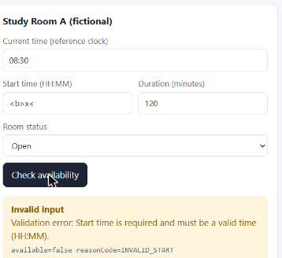{width=40%} 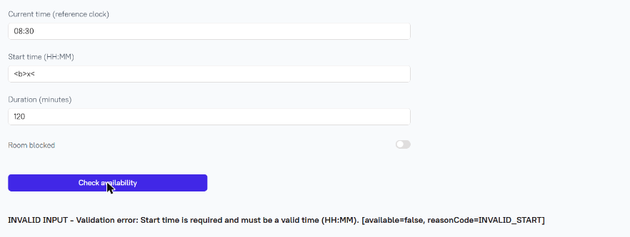{width=58%}

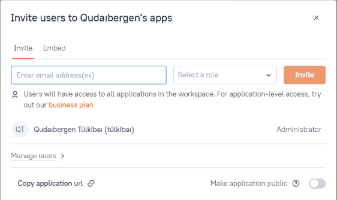{width=55%}

\newpage

# Comparison matrix

| Criterion | Code-based | Low-code |
|-----------|------------|----------|
| Functional tests | 8 / 8 | 8 / 8 |
| Build and repair time | ~3.6 min | ~11 min (incl. tests) |
| Customization | full control of layout, messages and responsive CSS | widgets and themes; custom logic needed a JS object; layout limited by the grid canvas |
| Security controls | my own validation, `textContent`, no dependencies, no secrets | same validation in JS object; platform handles hosting and access roles; app-level access control needs a paid plan (shown in the Share dialog) |
| Versioning / portability | Git diffs, one portable HTML file, automated tests | auto-save without diffs; JSON export runs only on Appsmith; Git connect available |
| Ongoing cost | free (static page) | free plan for this app; paid plans for extra access control and features |

**Recommendation:** for this checker I would keep the **code-based** version. Both passed all 8 tests, but the code version was faster to build and fix, has automated tests and normal Git review, and does not depend on one platform. Appsmith makes sense when a team needs quick internal forms on top of real data sources and accepts the platform lock-in, but here the booking rules still had to be written as a script, so low-code saved no work.

# AI-use reflection

I used Claude Opus 5.5 as the main tool: it wrote the contract, the rules, the tests, the Appsmith JS object, and it also built the Appsmith app by controlling my Chrome. I followed the slide prompts: keep the six criteria unchanged, fictional data only, rules separate from presentation, and no invented test results - every result in the table comes from a real run and has a screenshot. The AI was very fast on the code part. On the low-code part it struggled with the visual editor (lost property edits, widgets moved by reflow), and it had to rebuild part of the layout, so a visual tool is not automatically easier for an AI agent. I checked the outputs myself and I signed in to Appsmith and GitHub myself; the AI did not enter any passwords.
